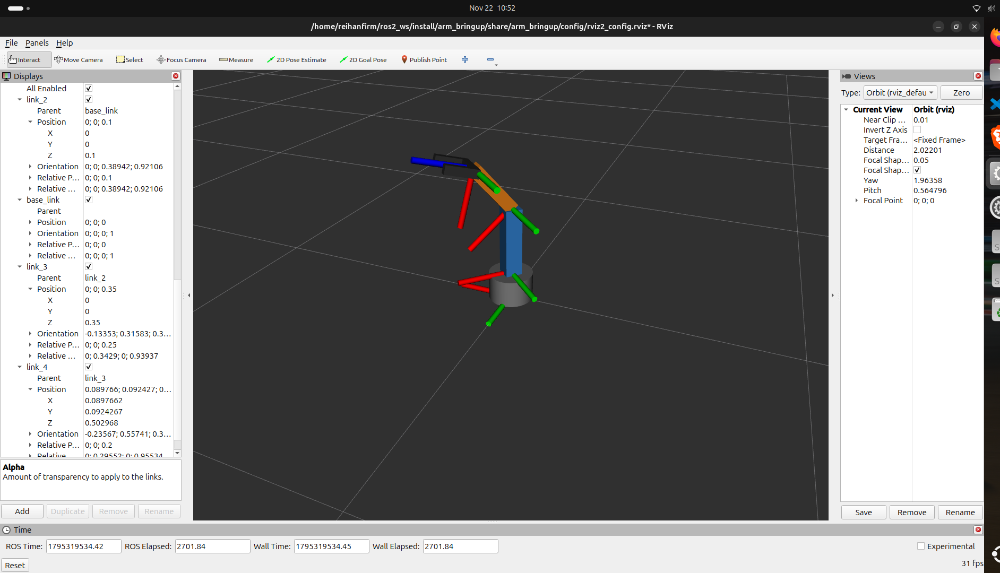
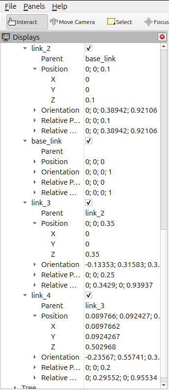
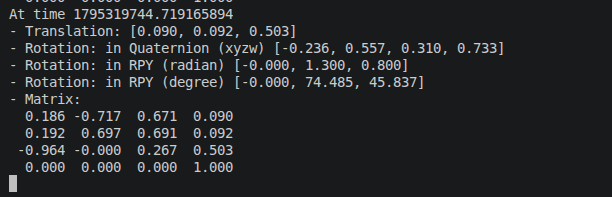

# Laporan Tugas ROS 2 Jazzy — 3-DoF Robotic Arm (`ros2_control` & Forward Kinematics)

- **Nama:** Reihan Firmansyah
- **Framework:** ROS 2 Jazzy (`ros2_control`, RViz2, `tf2_ros`)
- **Packages:** `arm_model`, `arm_bringup`, `arm_control`

---

## Soal 1 — Arsitektur `ros2_control` & Launch System

### 1. Kegunaan Tag `<ros2_control>` pada File URDF
Tag `<ros2_control>` di dalam `arm.urdf` berfungsi sebagai **jembatan penghubung** antara model fisik robot (URDF) dengan framework `ros2_control` (`controller_manager`). Di dalam tag ini didefinisikan:
- **Hardware Plugin:** Menggunakan `mock_components/GenericSystem` sebagai simulasi aktuator virtual tanpa memerlukan perangkat keras fisik.
- **Interface per Joint (`joint_1`, `joint_2`, `joint_3`):**
  - `command_interface` (`position`): jalur input agar controller dapat mengirim perintah sudut target ke tiap joint.
  - `state_interface` (`position`): jalur output agar sistem dapat membaca posisi sudut aktual tiap joint secara *real-time*.

### 2. Tipe Plugin Controller yang Digunakan
Didefinisikan di `src/arm_bringup/config/arm.controllers.yaml` (dengan `update_rate: 50 Hz`):
1. **`joint_state_broadcaster/JointStateBroadcaster`** (`joint_state_broadcaster`)  
   Membaca seluruh status posisi joint dari hardware interface lalu mem-publish ke topik `/joint_states` agar `robot_state_publisher` dan RViz2 dapat memperbarui posisi visual serta TF robot.
2. **`position_controllers/JointGroupPositionController`** (`arm_controller`)  
   Menerima array perintah posisi sudut (`std_msgs/msg/Float64MultiArray`) pada topik `/arm_controller/commands` untuk menggerakkan `joint_1`, `joint_2`, dan `joint_3` secara bersamaan.

### 3. Node yang Dijalankan di `bringup.launch.py`
| No | Node | Package | Fungsi Utama |
| :-: | :--- | :--- | :--- |
| 1 | `robot_state_publisher` | `robot_state_publisher` | Membaca `arm.urdf`, mem-publish `/robot_description`, serta menghitung transformasi TF tiap link berdasarkan `/joint_states`. |
| 2 | `ros2_control_node` | `controller_manager` | Menjalankan `controller_manager` untuk memuat hardware interface (`arm_ros2_control`) dan konfigurasi `arm.controllers.yaml`. |
| 3 | `controller_spawner` | `controller_manager` | Memuat (*load*), mengonfigurasi (*configure*), dan mengaktifkan (*activate*) `joint_state_broadcaster` serta `arm_controller` secara otomatis. |
| 4 | `rviz2` | `rviz2` | Menampilkan visualisasi 3D robot (`RobotModel`) dan sistem koordinat (`TF`) menggunakan konfigurasi `rviz2_config.rviz`. |

---

## Soal 2 — Forward Kinematics (Posisi XYZ `joint_3`)

### 1. Struktur Rantai Kinematik & Identifikasi Warna Robot
Rantai kinematik pada `arm.urdf` adalah:

`base_link` ──(`joint_1`)──▶ `link_2` ──(`joint_2`)──▶ `link_3` ──(`joint_3`)──▶ `link_4`

Karena penamaan link bergeser satu angka dari contoh soal, **titik posisi `joint_3` pada TF RViz adalah origin dari frame `link_4`**.

#### Keterangan Warna Bagian Robot (Visual di RViz)
| Warna di RViz | Nama Link | Dimensi / Parameter | Keterangan |
| :--- | :--- | :--- | :--- |
| **Abu-abu** (silinder bawah) | `base_link` | $L_0 = 0.10\text{ m}$ | Dasar/pondasi robot (Fixed Frame `0, 0, 0`). |
| **Biru** (balok vertikal) | `link_2` | $L_1 = 0.25\text{ m}$ | Lengan bawah; diputar oleh `joint_1` terhadap sumbu **Z**. |
| **Oranye** (balok miring) | `link_3` | $L_2 = 0.20\text{ m}$ | Lengan atas; dimiringkan oleh `joint_2` terhadap sumbu **Y**. |
| **Hitam** (capit/gripper) | `link_4` | Titik target (`joint_3`) | End-effector; diputar oleh `joint_3` terhadap sumbu **Y**. |

#### Keterangan Warna Sumbu Koordinat TF (Aturan RGB = XYZ)
- **Merah (Red)** = Sumbu **X**
- **Hijau (Green)** = Sumbu **Y** (sumbu putar/engsel untuk `joint_2` dan `joint_3`)
- **Biru (Blue)** = Sumbu **Z** (sumbu vertikal / sumbu putar untuk `joint_1`)

---

### 2. Parameter & Input
- **Parameter Jarak (dari `arm.urdf`):**
  - $L_0 = 0.10\text{ m}$ (jarak `base_link` → `joint_1`)
  - $L_1 = 0.25\text{ m}$ (jarak `joint_1` → `joint_2` / panjang `link_2`)
  - $L_2 = 0.20\text{ m}$ (jarak `joint_2` → `joint_3` / panjang `link_3`)
- **Input Sudut (dari `arm_publisher.py`):**
  - $\theta_1$ (`joint_1`) $= 0.8\text{ rad}$ ($\approx 45.84^\circ$)
  - $\theta_2$ (`joint_2`) $= 0.7\text{ rad}$ ($\approx 40.11^\circ$)
  - *(Catatan: nilai $\theta_3$ / `joint_3` $= 0.6\text{ rad}$ hanya mengubah orientasi/kemiringan gripper `link_4`, tidak menggeser koordinat XYZ titik pusat `joint_3`.)*

---

### 3. Penurunan Rumus (Translasi & Trigonometri Sin–Cos)

Perhitungan dilakukan secara bertahap dari `base_link` hingga `link_4`:

1. **Tahap 1 — `base_link` ke `link_2` (`joint_1`):**  
   Bergeser lurus ke atas sepanjang tinggi `base_link` ($L_0$):

   $$P_{\text{link 2}} = (0, \; 0, \; L_0) = (0, \; 0, \; 0.10\text{ m})$$

2. **Tahap 2 — `link_2` ke `link_3` (`joint_2`):**  
   Meskipun `joint_1` berputar sebesar $\theta_1$ pada sumbu $Z$, batang biru (`link_2`) tetap berdiri vertikal searah sumbu $Z$ sepanjang $L_1$, sehingga tidak ada pergeseran di $X$ maupun $Y$:

   $$P_{\text{link 3}} = (0, \; 0, \; L_0 + L_1) = (0, \; 0, \; 0.35\text{ m})$$

3. **Tahap 3 — `link_3` ke `link_4` (`joint_3`):**  
   Batang oranye (`link_3`) sepanjang $L_2$ dimiringkan sebesar $\theta_2$ (terhadap sumbu $Y$) dan diputar arah hadapnya sebesar $\theta_1$ (terhadap sumbu $Z$). Dipecah menjadi dua segitiga siku-siku:
   - **Tampak Samping (akibat $\theta_2$):**
     - Tambahan tinggi vertikal: $\Delta Z = L_2 \cos(\theta_2)$
     - Proyeksi mendatar (bayangan di bidang $XY$): $r = L_2 \sin(\theta_2)$
   - **Tampak Atas (akibat $\theta_1$):**  
     Proyeksi mendatar $r$ diputar sebesar $\theta_1$ dari sumbu $+X$:
     - Pergeseran sumbu $X$: $\Delta X = r \cos(\theta_1) = L_2 \sin(\theta_2) \cos(\theta_1)$
     - Pergeseran sumbu $Y$: $\Delta Y = r \sin(\theta_1) = L_2 \sin(\theta_2) \sin(\theta_1)$

4. **Rumus Akhir Posisi `joint_3` (`link_4`) terhadap `base_link`:**

   $$\begin{aligned} X &= L_2 \sin(\theta_2) \cos(\theta_1) \\ Y &= L_2 \sin(\theta_2) \sin(\theta_1) \\ Z &= L_0 + L_1 + L_2 \cos(\theta_2) \end{aligned}$$

---

### 4. Hasil Perhitungan Manual ($\theta_1 = 0.8\text{ rad}$, $\theta_2 = 0.7\text{ rad}$)

Diketahui nilai trigonometri (dalam radian):
- $\sin(0.7) \approx 0.6442177$
- $\cos(0.7) \approx 0.7648422$
- $\sin(0.8) \approx 0.7173561$
- $\cos(0.8) \approx 0.6967067$

Maka:

1. **Proyeksi mendatar $r$:**

   $$r = 0.20 \times \sin(0.7) = 0.20 \times 0.6442177 = 0.1288435\text{ m}$$

2. **Koordinat $X$:**

   $$X = 0.1288435 \times \cos(0.8) = 0.1288435 \times 0.6967067 = \mathbf{0.0897662\text{ m}}$$

3. **Koordinat $Y$:**

   $$Y = 0.1288435 \times \sin(0.8) = 0.1288435 \times 0.7173561 = \mathbf{0.0924267\text{ m}}$$

4. **Koordinat $Z$:**

   $$Z = 0.10 + 0.25 + (0.20 \times 0.7648422) = 0.35 + 0.1529684 = \mathbf{0.5029684\text{ m}}$$

---

### 5. Validasi dengan RViz2 TF & `tf2_echo`

Perintah validasi di terminal:
```bash
ros2 run tf2_ros tf2_echo base_link link_4
```

#### Tabel Perbandingan Hasil
| Sumbu | Hitungan Manual (Rumus) | RViz2 TF (`link_4`) | Output `tf2_echo` (3 desimal) | Selisih |
| :---: | :---: | :---: | :---: | :---: |
| **X** | `0.0897662 m` | `0.0897662 m` | `0.090 m` | `0.0000` |
| **Y** | `0.0924267 m` | `0.0924267 m` | `0.092 m` | `0.0000` |
| **Z** | `0.5029684 m` | `0.502968 m` | `0.503 m` | `0.0000` |

Hasil perhitungan manual cocok **100%** dengan data transformasi TF di ROS 2 (perbedaan pada `tf2_echo` semata-mata karena pembulatan ke 3 angka di belakang koma).

#### Dokumentasi Pengujian
- **Visualisasi RViz2 (Model Robot & Sumbu TF):**  
  
- **Detail Koordinat TF per Link di RViz2 (`base_link` → `link_4`):**  
  
- **Validasi Terminal (`tf2_echo`):**  
  

---

### 6. Program Python Pendukung (`fk_calculator.py`)

File tersimpan di `src/arm_control/arm_control/fk_calculator.py`:

```python
import math

# Parameter dimensi dari arm.urdf (meter)
L0 = 0.10  # base_link -> joint_1
L1 = 0.25  # joint_1 -> joint_2 (link_2)
L2 = 0.20  # joint_2 -> joint_3 (link_3)

def forward_kinematics(theta1_rad, theta2_rad):
    r = L2 * math.sin(theta2_rad)
    x = r * math.cos(theta1_rad)
    y = r * math.sin(theta1_rad)
    z = L0 + L1 + L2 * math.cos(theta2_rad)
    return x, y, z

if __name__ == '__main__':
    q1 = 0.8
    q2 = 0.7
    x, y, z = forward_kinematics(q1, q2)
    print(f"Input  : joint_1 = {q1} rad, joint_2 = {q2} rad")
    print(f"Output : X = {x:.7f} m, Y = {y:.7f} m, Z = {z:.7f} m")
```

---

## Cara Menjalankan Proyek

```bash
# 1. Build workspace
cd ~/ros2_ws
colcon build --symlink-install
source install/setup.bash

# 2. Terminal 1 — Jalankan bringup (robot, controller, dan RViz2)
ros2 launch arm_bringup bringup.launch.py

# 3. Terminal 2 — Jalankan node publisher perintah posisi sudut
source install/setup.bash
ros2 run arm_control arm_publisher

# 4. Terminal 3 — Cek posisi aktual joint_3 (link_4) terhadap base_link
source install/setup.bash
ros2 run tf2_ros tf2_echo base_link link_4
```